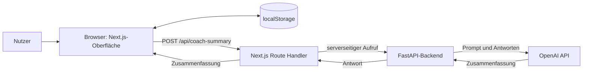
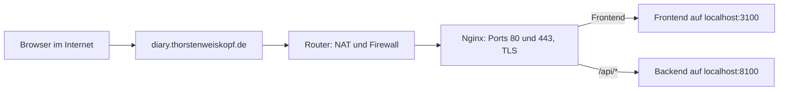

# Aktuelle Architektur von Morning Coach

Dieses Dokument beschreibt den Stand des Repositories und die im Gespräch
beschriebene Installation auf dem Heimserver. Der Vercel-Service-Verbund ist
konfiguriert, aber die Bereitstellung auf Vercel ist noch ausstehend; siehe
[Vercel-Todo-Liste](../VERCEL-TODO.md).

## Überblick

Morning Coach ist eine Webanwendung mit einem Next.js-Frontend und einem
zustandslosen FastAPI-Backend. Check-ins und Journaleinträge liegen im Browser.
Das Backend dient der optionalen Generierung einer Coach-Zusammenfassung und
speichert keine Journaldaten.

Die Next.js-Anwendung wird vom Server ausgeliefert, aber das Journal wird im
Browser verarbeitet und gespeichert. Der Browser ruft für Coach Summaries
eine gleich-originige Next.js-Route auf, die den Request serverseitig an
FastAPI weiterleitet. Der Handler ist unter
[route.ts](../frontend/app/api/coach-summary/route.ts) implementiert.

## Komponenten

| Komponente | Aufgabe | Relevante Dateien |
|---|---|---|
| Next.js und React | Seiten, Interaktion, Onboarding, Check-in und Journal | [frontend/app](../frontend/app), [frontend/components](../frontend/components) |
| Personal Journal Store | Browserlokale Check-ins, Snapshots, Export und Löschung | [personal-journal-store.ts](../frontend/lib/personal-journal-store.ts) |
| Lokaler API-Client | Verbindet Oberfläche, Journal Store und optionalen Coach-Aufruf | [default-client.ts](../frontend/lib/api/default-client.ts) |
| HTTP-Client | Ruft die gleich-originige Next.js-Coach-Route auf | [client.ts](../frontend/lib/api/client.ts) |
| Next.js Route Handler | Leitet Coach-Anfragen serverseitig an FastAPI weiter | [route.ts](../frontend/app/api/coach-summary/route.ts) |
| FastAPI | Health-Check, Validierung und Coach-Summary-Endpunkt | [main.py](../backend/app/main.py), [models.py](../backend/app/models.py) |
| Coach Summary Generator | Erstellt den Prompt und ruft OpenAI auf | [coach_summary.py](../backend/app/coach_summary.py) |

Das Frontend verwendet TypeScript, React und den Next.js App Router. Das
Backend verwendet Python, FastAPI und Uvicorn. Beide Dienste besitzen ein
eigenes Dockerfile.

## Oberfläche und Anwendungsschichten

Die wichtigsten Seiten sind `/` für den Einstieg, `/check-in` für den
Morning Check-in, `/journal` für die Übersicht und `/journal/[id]` für einen
einzelnen Daily Snapshot. Das Root-Layout bindet die Theme-Verwaltung und den
lokalen Profil-Zugang ein.

Der `PersonalJournalApiClient` stellt der Oberfläche eine gemeinsame
Schnittstelle bereit. Die Standardimplementierung führt Journaloperationen
über den browserlokalen Store aus und verwendet HTTP nur für die optionale
Coach-Zusammenfassung. Das Backend ist **keine Journal-Datenbank** und bietet
keine Journal-CRUD-Endpunkte.

## Daten und Speicherung

Der Personal Journal Store hält unter dem Schlüssel
`morning-coach.personal-journal` ein versioniertes JSON-Dokument:

| Feld | Inhalt |
|---|---|
| `version` | Schema-Version; aktuell `1` |
| `unfinished_checkins` | Begonnene, noch nicht abgeschlossene Check-ins |
| `snapshots` | Abgeschlossene Daily Snapshots einschließlich Coach-Status |

Ein Check-in enthält unter anderem eine ID, den browserlokalen Kalendertag,
sechs Antworten und den Fortschritt. Pro Tag kann höchstens ein Snapshot
abgeschlossen werden. Antworten abgeschlossener Snapshots sind nicht mehr
bearbeitbar; eine Coach-Zusammenfassung kann nachträglich gespeichert oder
bei einem verfügbaren Retry erneut angefordert werden.

Weitere browserlokale Schlüssel:

- `morning-coach.user-profile`: Name, PIN und Sicherheitsfrage mit Antwort.
- `morning-coach.coach-summary-enabled`: Einstellung für die optionale
  Coach-Funktion.
- `morning-coach.theme`: Theme-Auswahl.

Das Journal lässt sich als JSON exportieren und lokal löschen. Der Export
enthält die abgeschlossenen Snapshots. Ein automatisches Backup oder eine
Synchronisierung zwischen Geräten existiert nicht.

`localStorage` ist an Browserprofil und Origin (Schema, Host und Port)
gebunden. Ein Domainwechsel führt deshalb zu einem getrennten Speicher.
Browserdaten können durch das Löschen des Browserprofils verloren gehen und
sind durch die Anwendung nicht verschlüsselt.

## Ablauf eines Check-ins

1. Das Frontend lädt oder erstellt einen Check-in für den lokalen Kalendertag.
2. Nach einer optional überspringbaren Atemübung werden sechs Fragen
   nacheinander angezeigt. Antworten und Fortschritt werden lokal gespeichert.
3. Nach der letzten Frage wird der Daily Snapshot **zuerst lokal**
   abgeschlossen.
4. Falls die Coach-Funktion aktiviert ist und mindestens eine Antwort vorliegt,
   sendet der Browser die aktuellen Antworten an das Backend.
5. Die Antwort wird lokal am Snapshot gespeichert. Bei Fehler, Timeout oder
   nicht konfigurierter KI bleibt der Snapshot erhalten; die Zusammenfassung
   wird als nicht verfügbar markiert und kann gegebenenfalls erneut versucht
   werden.

Das Frontend wartet derzeit höchstens zehn Sekunden auf das Ergebnis. Ein
vollständig leerer Check-in und eine deaktivierte Coach-Funktion lösen keinen
KI-Aufruf aus.

## Backend und Coach-API

Das Backend stellt im Anwendungscode folgende Endpunkte bereit:

| Methode und Pfad | Funktion |
|---|---|
| `GET /health` | Einfacher Health-Check mit `{"status":"ok"}` |
| `POST /api/coach-summary` | Optionale Generierung einer Coach-Zusammenfassung |

Der Browser ruft den gleichnamigen Next.js-Pfad auf. In Vercel verwendet der
Route Handler das Service Binding `BACKEND_URL`; lokal verwendet er
`BACKEND_BASE_URL`. Er leitet ausschließlich die Coach-Summary-Anfrage weiter,
prüft Content-Type und JSON, begrenzt den Body auf 16 KiB und setzt einen
Upstream-Timeout. Die Anwendung prüft weiterhin keine Benutzeridentität und
enthält selbst kein verteiltes Rate-Limit.

Die Coach-Anfrage enthält sechs Antworten und `target_language` (`de` oder
`en`). Das Backend validiert Form und Typen der Antworten, bestimmt die
vorherrschende Sprache anhand der Antworten selbst und ruft bei vorhandener
Konfiguration OpenAI auf. Der aktuelle Generator verwendet `gpt-4o-mini`.
Er sendet die Antworten und einen Prompt für eine kurze, unterstützende,
nicht-klinische Reflexion.

Die Antwort hat die Form `{"status":"available","summary":"..."}` oder
`{"status":"unavailable","summary":null}`. Ohne API-Key oder bei einem
Generierungsfehler liefert das Backend `unavailable`; der lokale Snapshot
bleibt davon unabhängig.

Der OpenAI-Key wird serverseitig über `OPENAI_API_KEY` aus der Umgebung oder
der Backend-`.env` geladen. Er ist nicht für das Frontend vorgesehen. Die
Anwendungslogs melden unter anderem Start und Generierungsfehler, nicht
absichtlich die eingegebenen Antworten.

## Sicherheit und Datenschutz

- Das Profil ist ein **lokales Soft-Gate**, kein serverseitiges Benutzerkonto.
  PIN und Antwort auf die Sicherheitsfrage liegen unverschlüsselt im
  `localStorage`; die Prüfung erfolgt im Browser.
- Die Coach-API prüft im aktuellen Anwendungscode keine Benutzeridentität und
  implementiert dort kein Rate-Limit. Ob außerhalb der Anwendung zusätzlicher
  Schutz besteht, hängt von der jeweiligen Serverkonfiguration ab.
- Die CORS-Voreinstellung erlaubt `http://localhost:3000` und
  `http://127.0.0.1:3000`. CORS ist keine Authentifizierung und verhindert
  keine direkten API-Aufrufe durch andere Clients.
- Beim optionalen Coach-Aufruf werden aktuelle Antworten über das Backend an
  OpenAI übermittelt. Sie können persönliche Informationen enthalten.
- Eine Kompromittierung des Frontends oder einer Skript-Abhängigkeit kann den
  Zugriff auf browserlokale Daten ermöglichen. HTTPS schützt den Transport,
  ersetzt aber weder Zugriffsschutz noch Schutz des Servers.

Die Architekturentscheidungen sind in
[ADR-0001](../docs/adr/0001-user-profile-as-client-side-soft-gate.md) und
[ADR-0002](../docs/adr/0002-browser-local-personal-journal-architecture.md)
dokumentiert.

## Betrieb und Deployment

### Docker Compose im Repository

[compose.yaml](../compose.yaml) baut zwei Container:

| Dienst | Container-Port | Standard-Port auf dem Host |
|---|---:|---:|
| Frontend | `3000` | `3000` |
| Backend | `8000` | `8000` |

Der Next.js-Container wird als Standalone-Build ausgeführt; das Backend
startet Uvicorn. Beide Dockerfiles verwenden einen nicht privilegierten
Anwendungsnutzer. Compose veröffentlicht die Ports ohne Beschränkung auf
`127.0.0.1`; die tatsächliche externe Erreichbarkeit hängt zusätzlich von
Host-Firewall und Router ab.

Compose konfiguriert beim Frontend-Container
`BACKEND_BASE_URL=http://backend:8000`. Beim direkten lokalen Start wird
`BACKEND_BASE_URL=http://localhost:8000` gesetzt. Diese serverseitige Variable
wird nicht in den Browser-Build eingebettet; der Browser ruft nur
`/api/coach-summary` auf.

### Bestehender Heimserver

Nach Nutzerangabe wird die Anwendung aktuell über DNS, Router und Nginx
bereitgestellt:

Die Server- und Nginx-Konfiguration ist nicht Bestandteil dieses Repositories;
die Darstellung beruht auf der Beschreibung des Nutzers. Die genannten
Host-Ports weichen von den Compose-Standardwerten im Repository ab. Laut
Beschreibung leitet Nginx `/api/*` direkt an das Backend weiter; damit wird
die Next.js-Route auf diesem Heimserver-Setup umgangen. Bei einer Umstellung
auf Next.js-Weiterleitung müsste Nginx `/api/coach-summary` an das Frontend
leiten, wenn dort derselbe Request-Pfad verwendet werden soll. Der öffentliche
API-Pfad über Nginx ist ohne zusätzliche Maßnahmen weiterhin direkt aufrufbar.

## Tests

Frontend-Tests liegen unter [frontend/tests](../frontend/tests) und verwenden
Vitest. Backend-Tests liegen unter [backend/tests](../backend/tests) und
verwenden pytest. Die lokalen Befehle stehen in den jeweiligen
[Frontend-](../frontend/README.md) und [Backend-READMEs](../backend/README.md).

## Weiterführend

- [Produktbeschreibung](./app.md)
- [Repository-README](../README.md)
- [Fachbegriffe](../GLOSSARY.md)
- [Geplante Vercel-Migration](../VERCEL-TODO.md)
